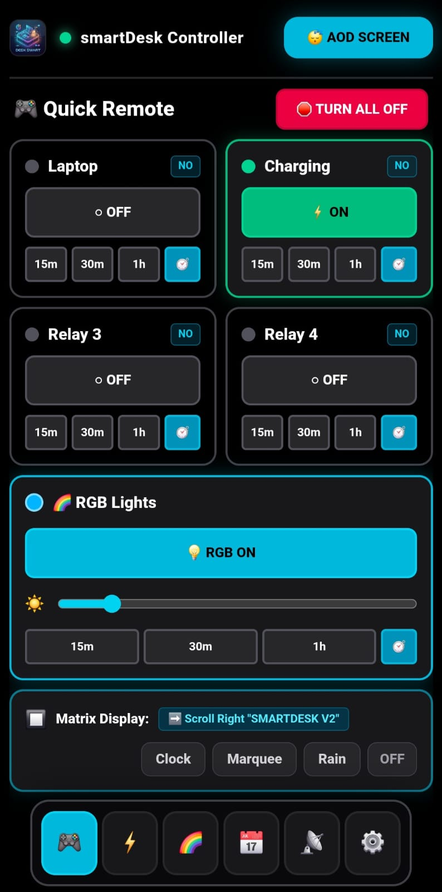

# SmartDesk Controller

SmartDesk is an ESP32-S3-powered desk controller. Use its Bluetooth-connected
web app to switch charging outlets for your phone and laptop, control desk
lighting, and manage the matrix display.

## What it can do

- Turn relay-controlled outlets on or off, with quick timers and an all-off control.
- Control RGB lighting, brightness, and LED effects.
- Show a clock, scrolling messages, and other modes on the LED matrix.
- Connect to the controller over Bluetooth LE; no Wi-Fi or cloud account needed.

The relays switch power to your phone or laptop charger; they do not charge
devices directly.

## Hardware

| Part | Purpose |
| --- | --- |
| ESP32-S3 | Runs the controller and Bluetooth connection |
| 4 relay outputs (GPIO 4–7) | Switch connected desk outlets |
| WS2812B RGB LED strip (GPIO 8) | Desk lighting and effects |
| LED matrix (GPIO 11) | Clock, scrolling text, and display modes |
| DHT11 sensor (GPIO 9) | Temperature and humidity |
| Active buzzer (GPIO 10) | Sound feedback |

Use properly rated power components and enclosures. Mains-voltage wiring can
cause serious injury or fire; have it installed and checked by a qualified
person.

## How the software fits together

```text
Phone / laptop browser
        │
        │ Bluetooth LE
        ▼
PWA web app ──────── Quick Remote, timers, lighting, display controls
        │
        ▼
ESP32-S3 firmware ── Relays, RGB strip, LED matrix, sensor, buzzer
```

## Code layout

```text
smartdesk-v2/
├── firmware/
│   └── smartdesk/       ESP32-S3 firmware
├── pwa/                 Next.js web app
│   ├── app/             App pages
│   ├── components/      Reusable interface components
│   └── hooks/           UI and device state
└── README.md
```

## Project photos

<div align="center">
  
  
</div>

## Web app

The Quick Remote screen puts relay, timer, lighting, and matrix controls in one
place.



To run the app locally, install [Node.js](https://nodejs.org/), then run:

```powershell
cd smartdesk-v2\pwa
npm ci
npm run dev
```

Open [http://localhost:3000](http://localhost:3000) in a Bluetooth-capable
browser. Bluetooth control requires the ESP32-S3 controller to be powered on
and nearby.

## Firmware

Firmware and flashing instructions are in
[smartdesk-v2/firmware/README.md](smartdesk-v2/firmware/README.md). The provided
flash script is restricted to **COM6**.
